# Online Retail Lakehouse Pipeline

An incremental batch data engineering pipeline built with **Amazon S3,
AWS IAM, Apache Airflow, Databricks, PySpark, Delta Lake, and Unity
Catalog**. The project prepares monthly retail transaction batches,
lands them in S3, processes them through Bronze, Silver, and Gold Delta
layers stored in S3, and validates, audits, and handles failures through
an Airflow-orchestrated workflow.

## Project overview

The source is the [Online Retail II dataset on
Kaggle](https://www.kaggle.com/datasets/mashlyn/online-retail-ii-uci),
supplied as an Excel workbook with two worksheets and **1,067,371
transaction records**.

The project has two stages:

1.  **Local source preparation:** Pandas preserves workbook lineage,
    combines the worksheets, derives monthly `batch_id` values, exports
    monthly CSV batches, and reconciles the exported row count with the
    source workbook.
2.  **AWS lakehouse processing:** Monthly CSV batches are uploaded to
    Amazon S3. An Apache Airflow DAG orchestrates Databricks notebook
    tasks to process the selected batch through Bronze, Silver, Gold,
    and validation. Operational records are stored in a Delta control
    table in S3.

## Architecture
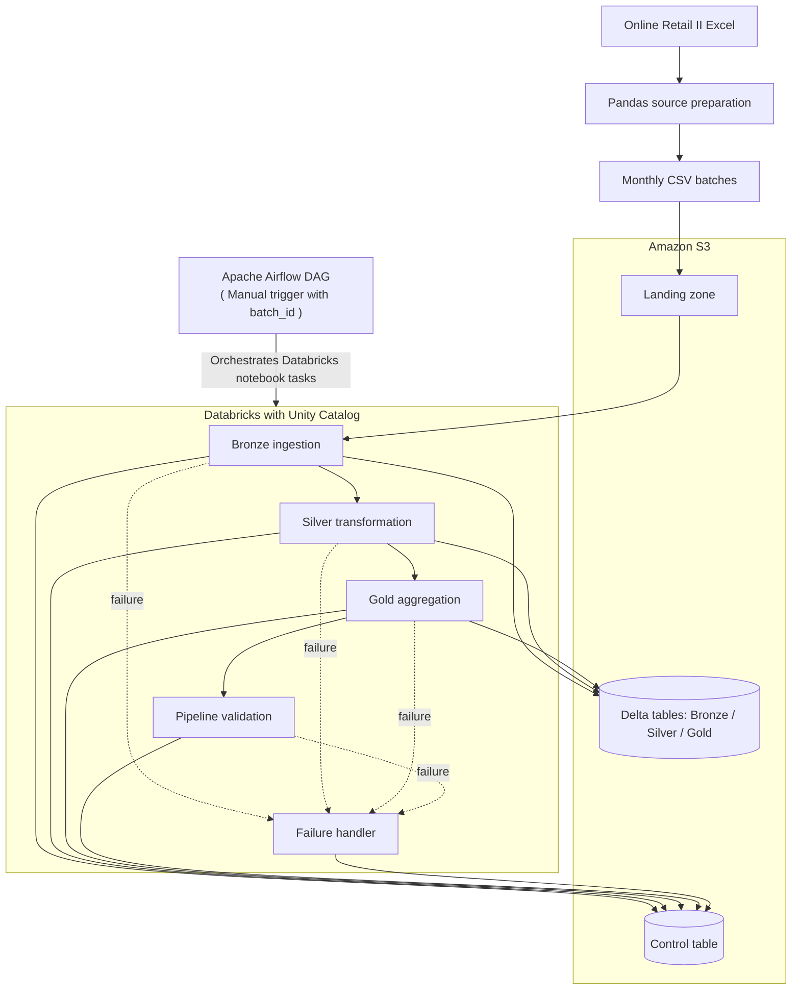

## Technology stack

| Technology | Purpose |
|---|---|
| Python and Pandas | Prepare monthly source batches |
| Amazon S3 and AWS IAM | Store source data and provide controlled access |
| Apache Airflow | Orchestrate tasks, retries, and failure handling |
| Docker Compose | Run Airflow locally |
| Databricks and PySpark | Transform and validate data |
| Delta Lake | Store tables and support idempotent `MERGE` operations |
| Unity Catalog | Govern tables and external locations |
| Databricks SQL | Query and monitor pipeline records |

## AWS and Unity Catalog

The project uses **Amazon S3 for data storage, AWS IAM for access control, and Databricks Unity Catalog for data governance**. Unity Catalog uses a storage credential and external locations to manage access to the S3 paths containing the source data and Delta tables.

### Storage and access architecture

- **Amazon S3:** Stores monthly source CSV files in the landing area and the data files and Delta transaction logs for the pipeline tables.
- **AWS IAM:** Provides the role and scoped S3 permissions required for access.
- **Unity Catalog:** Defines the storage credential and external locations used to access the S3 paths, and registers the pipeline tables for governed access.

The S3 bucket used by the project is `online-retail-databricks`. The Delta tables are stored under `s3://online-retail-databricks/tables/airflow/` and registered in the Unity Catalog catalog `online_retail_aws_airflow`.

### Registered Delta tables

| Table | Purpose |
|---|---|
| `bronze.transactions_raw` | Ingested transaction records with source lineage |
| `silver.transactions_clean` | Cleaned, deduplicated, and quality-flagged records |
| `gold.product_sales_summary` | Monthly product-level sales metrics |
| `control.pipeline_runs` | Pipeline task statuses, row counts, timestamps, and error details |

All four tables are registered as **external Delta tables**. Their underlying data files and Delta transaction logs are stored in S3, while Unity Catalog provides the metadata and governed access used by Databricks.

## Data processing

The pipeline transforms monthly source files into progressively cleaner and more analytical Delta tables. Each batch is identified by `batch_id` in `YYYY-MM` format and processed through three layers: Bronze for ingestion, Silver for cleaning, and Gold for aggregation.

### 1. Source preparation

The notebook `notebooks/01_prepare_monthly_batches.ipynb` prepares the Online Retail II workbook for incremental processing.

- Reads both worksheets using Pandas.
- Preserves source lineage through `source_sheet` and `source_row_number`.
- Derives a `batch_id` from each transaction's date and exports monthly CSV files.
- Reconciles the exported records against the **1,067,371 source rows**.

The selected monthly CSV is uploaded to the S3 landing path for ingestion.

### 2. Bronze — raw ingestion

The Bronze layer ingests the selected monthly CSV into `bronze.transactions_raw`, preserving the source data and its lineage.

- Applies an explicit PySpark schema and validates the `batch_id` format.
- Normalizes column names and adds file metadata and an ingestion timestamp.
- Generates a stable SHA-256 `record_id` from the source worksheet and row identifiers.
- Validates row counts and record-key integrity.
- Uses an insert-only Delta `MERGE` to avoid inserting the same source records again during reruns.

**Purpose:** Maintain a traceable ingested dataset while supporting safe reprocessing of previously ingested records.

### 3. Silver — cleaning and data quality

The Silver layer transforms Bronze records into a cleaned, standardized dataset stored in `silver.transactions_clean`.

- Profiles missing values, negative quantities, zero prices, and cancelled invoices.
- Uses deterministic `row_number()` logic to deduplicate business records and trims text fields.
- Normalizes customer IDs, adds data-quality and sale-status flags, and calculates `line_total`.
- Retains potentially genuine records with missing customer IDs or descriptions, as well as negative quantities, rather than automatically discarding them.
- Upserts records using `record_id`.

**Purpose:** Improve consistency and expose data-quality issues while preserving records that may be important for auditing or business analysis.

### 4. Gold — analytical aggregation

The Gold layer produces `gold.product_sales_summary`, a monthly product-level summary with one logical record per `batch_id + stock_code`.

It calculates:

- Total quantity and revenue from positive sales.
- Distinct invoice counts.
- Distinct customer counts.

The layer validates the composite merge key, reconciles aggregated measures against Silver, and synchronizes only the selected batch.

**Purpose:** Provide a summarized dataset that is easier to query for monthly product sales analysis without repeatedly processing the detailed transaction records.

## Reliability and validation

The pipeline uses three mechanisms to improve reliability and verify data correctness: Airflow failure handling, a Delta control table, and data reconciliation checks.

### Pipeline reliability and failure handling

The Airflow DAG `online_retail_pipeline` executes the Bronze, Silver, Gold, and validation notebooks in sequence. It passes the selected `batch_id` and Airflow run ID to the Databricks notebooks.

- **Retries:** Processing tasks have configured retries to handle transient failures.
- **Failure handling:** If a processing or validation task fails, a separate failure-handler task collects task statuses and error details and records them in the control table.
- **Visible failure status:** The failure handler raises an exception after recording the failure, ensuring that the Airflow DAG remains marked as failed rather than appearing successful.

### Run tracking and auditability

The Delta control table, `control.pipeline_runs`, records pipeline execution details using `run_id`, `batch_id`, and `layer_name` to distinguish records across runs, batches, and processing layers.

It stores task status, timestamps, input/output row counts, and error messages. The notebook `06_pipeline_monitoring.ipynb` provides standalone SQL queries for reviewing run history and investigating failures; it is not a task in the Airflow DAG.

### Data correctness and idempotency checks

The pipeline includes checks at different stages to detect inconsistencies and prevent duplicate records during reruns.

- **Ingestion checks:** Validates the batch ID, row counts, and record-key integrity.
- **Transformation checks:** Validates the Gold composite merge key and reconciles aggregated measures against Silver data.
- **Idempotency test:** Reprocessing batch `2009-12` left the stored row counts unchanged across Bronze, Silver, and Gold.
- **Failure-path test:** An intentional missing-source-file test using batch `2099-12` exercised the failure-handling path.

### Test results

| Test | Expected behavior | Observed result |
|---|---|---|
| Batch `2009-12` | Process data and support safe reruns | Successful; row counts remained unchanged on rerun |
| Batch `2099-12` | Surface a missing-source-file failure | Failed as expected; failure-handler path executed |
| Batches `2010-01` to `2010-03` | Process additional monthly batches | Successful end-to-end runs |

For batch `2009-12`, the rerun and reconciliation results were:

| Layer | First run | Rerun |
|---|---:|---:|
| Bronze | 45,228 | 45,228 |
| Silver | 44,722 | 44,722 |
| Gold | 3,057 | 3,057 |

Positive-sale measures also reconciled between Silver and Gold:

| Measure | Silver | Gold |
|---|---:|---:|
| Quantity | 425,461 | 425,461 |
| Revenue | 822,483.95 | 822,483.95 |

These results demonstrate successful batch execution, unchanged layer row counts on rerun, matching positive-sale measures, and execution of the tested failure-handling path.

## Execution evidence

### AWS and Unity Catalog setup

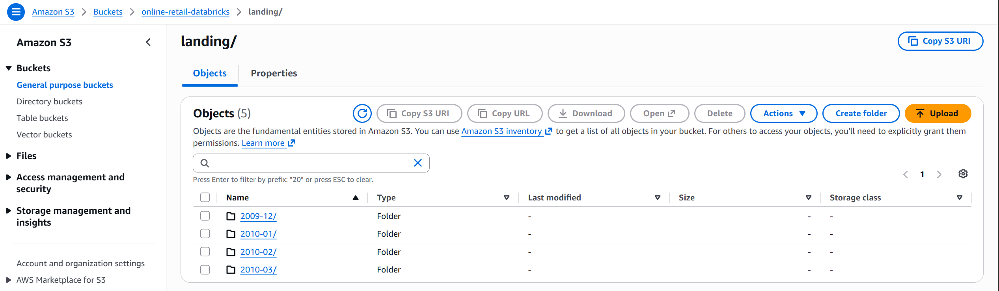

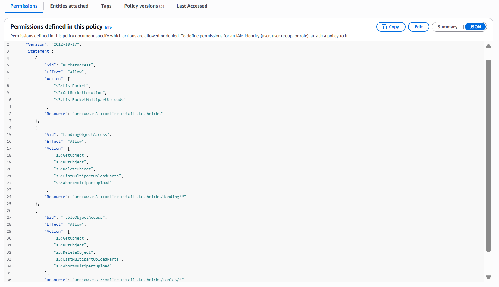

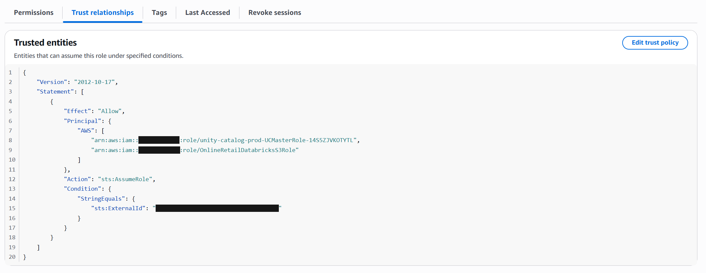

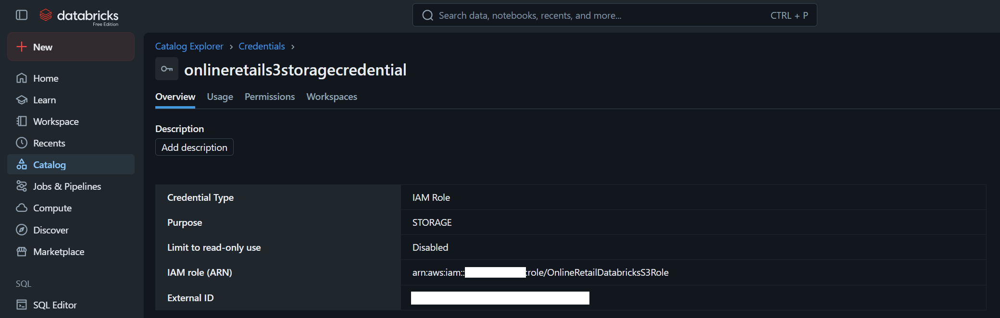

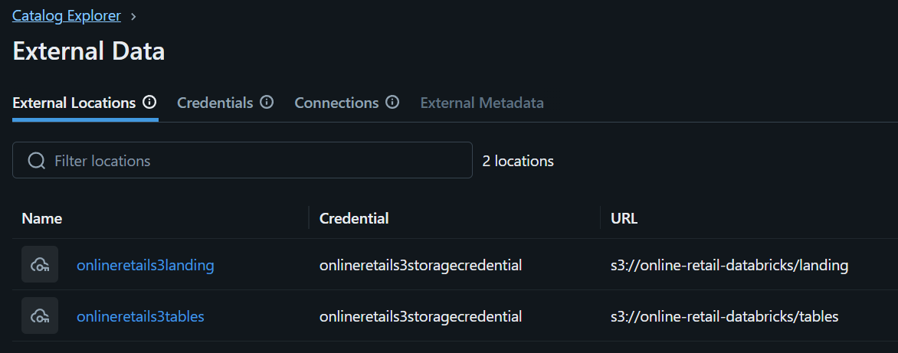

### Delta tables in S3

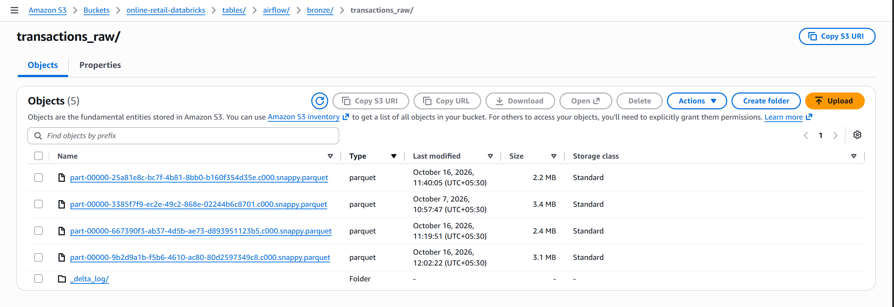

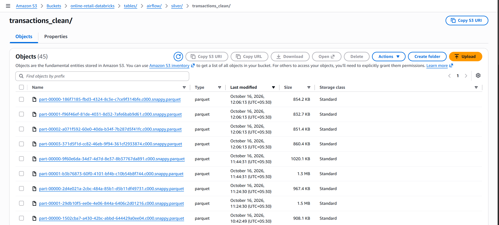

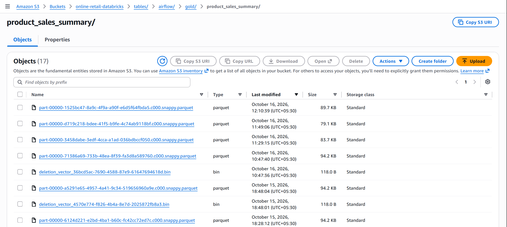

### Airflow runs

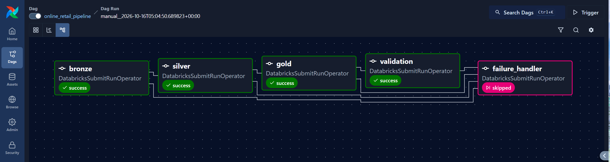

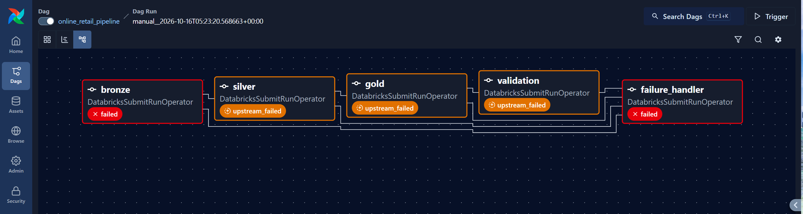

## Repository structure

```text
online-retail-lakehouse-pipeline-aws-airflow/
├── docs/
│   └── images/
├── notebooks/
│   ├── 01_prepare_monthly_batches.ipynb
│   └── databricks/
│       ├── 00_environment_setup.ipynb
│       ├── 01_bronze_ingestion.ipynb
│       ├── 02_silver_transformation.ipynb
│       ├── 03_gold_analytics.ipynb
│       ├── 04_pipeline_validation.ipynb
│       ├── 05_failure_handler.ipynb
│       └── 06_pipeline_monitoring.ipynb
├── airflow/
│   └── dags/
│       └── online_retail_pipeline.py
└── README.md
```

The Airflow DAG is located at `airflow/dags/online_retail_pipeline.py`. The `data/source/` and `data/monthly_batches/` directories are local working directories and are not included in the repository. Download the source workbook and generate the monthly CSV batches using the Pandas preparation notebook, as described in **How to run**.

The Docker Compose configuration and local Airflow environment files are maintained outside this repository. You must configure the Airflow environment and Databricks connection before running the pipeline. Do not commit credentials, access tokens, or other secrets.

## How to run

1. **Prepare batches:** Download the Online Retail II workbook from the Kaggle link above. From the repository root, create `data/source/` and `data/monthly_batches/`. Save the workbook as `data/source/online_retail_II.xlsx`, then run `notebooks/01_prepare_monthly_batches.ipynb` locally. The notebook writes the monthly CSVs to `data/monthly_batches/`.
2. **Configure AWS and Unity Catalog:** Set up the S3 bucket and prefixes, IAM access, storage credential, external locations, catalog, and schemas.
3. **Upload a batch:** Upload the selected CSV to `s3://online-retail-databricks/landing/YYYY-MM/online_retail_YYYY-MM.csv`.
4. **Configure Airflow:** Start the local Airflow environment with Docker Compose. Configure the Airflow connection `databricks_default` with the workspace host and securely stored access token. Set the Variables `bronze_table_path`, `silver_table_path`, and `gold_table_path` to their corresponding S3-backed table paths. Confirm that the notebook paths in the DAG match the deployed Databricks workspace paths.
5. **Run the DAG:** Open `http://localhost:8080`, select `online_retail_pipeline`, and trigger a run with a `batch_id` such as `2009-12`.
6. **Review results:** Check task status and logs in Airflow, and query `control.pipeline_runs` using `06_pipeline_monitoring.ipynb`.
